AN EDITORIAL PROFILE · DAVI06S

 

<strong>Full Stack Developer</strong> · Milano

Studente TTF Talent Factory - Junior Full Stack Developer

<a href="https://github.com/davi06s">GitHub</a> &nbsp;·&nbsp; <a href="https://davi06s.github.io/PORTFOLIO/">Website</a>

─────── ◇ ───────

<table width="100%" style="display:table;width:100%;table-layout:fixed;">
<tr>
<td width="58%" valign="top"><h2>The point of view</h2><blockquote>Studente TTF Talent Factory - Junior Full Stack Developer</blockquote>
Small teams, ambitious ideas, and useful collaborations.
</td>
<td width="42%" valign="top">
<code>PROFILE</code>

ROLE · Frontend or Full Stack Developer BASED · Milano FOCUS · WebApp

<strong>7</strong> repos <strong>179</strong> contributions <strong>5</strong> followers
</td>
</tr>
</table>

─────── ◇ ───────

<h2>In the current cut</h2>

The ideas, experiments, and decisions moving the work forward.

─────── ◇ ───────

<h2>Production palette</h2>

CSS · HTML · JavaScript · Java · Dockerfile · Python · tools chosen for the work, not the trend

─────── ◇ ───────

<h2>Featured reel</h2>

<table width="100%">
<tr>
<td width="33%" valign="top">
<strong><a href="https://github.com/Davi06s/PORTFOLIO">PORTFOLIO</a></strong>

PORTFOLIO

CSS · ⭐ 0
</td>
<td width="33%" valign="top">
<strong><a href="https://github.com/Davi06s/R-Type">R-Type</a></strong>

Sviluppo App

JavaScript · ⭐ 0
</td>
<td width="33%" valign="top">
<strong><a href="https://github.com/Davi06s/Sito-Moderno">Sito-Moderno</a></strong>

Restyling Sito Moderno

HTML · ⭐ 0
</td>
</tr>
</table>

─────── ◇ ───────

7 public projects · 0 stars · 179 contributions · 5 followers

─────── ◇ ───────

<h2>Contribution trail</h2>

<h2>Play the next move</h2>

─────── ◇ ───────

THE NEXT SCENE

<h2>Keep the story moving</h2>

I enjoy working with people who care about the details, share the context, and ship something useful.

<a href="https://github.com/davi06s">GitHub</a> &nbsp;·&nbsp; <a href="https://davi06s.github.io/PORTFOLIO/">Website</a>

Davide Schino · An Editorial Profile

